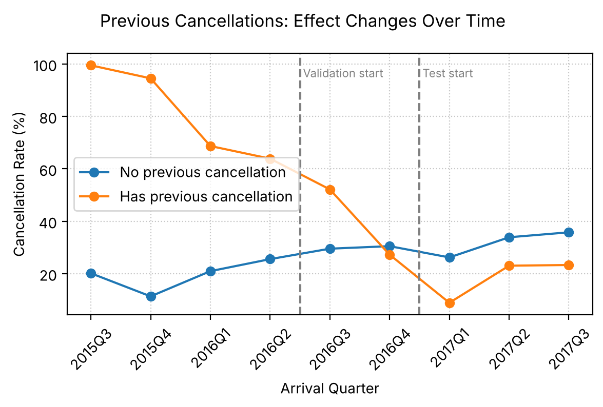
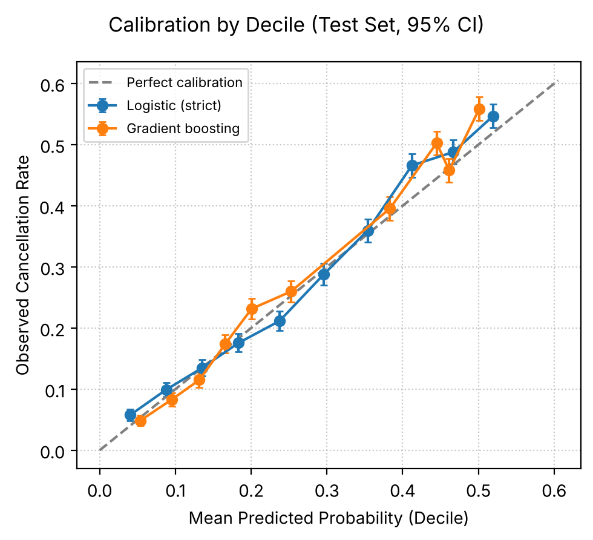
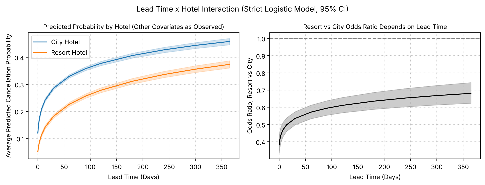
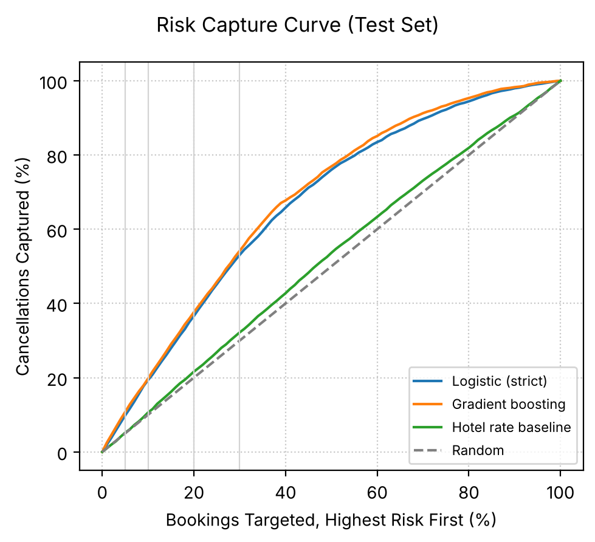
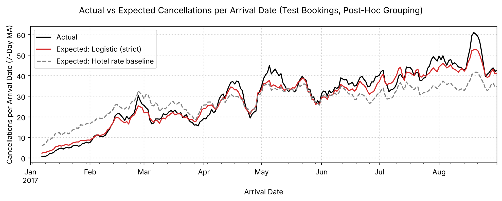

# Hotel Booking Cancellation: Risk Prediction and Decision Support


## Project Overview

**Business problem.** About one in three hotel bookings in this data is canceled. A hotel that knows *at booking time*
which reservations are likely to cancel can prioritize follow-up, plan inventory and judge whether retention actions pay off.

**Data.** 119,390 bookings for two Portuguese hotels, arrivals July 2015 – August 2017 ([Kaggle](https://www.kaggle.com/datasets/jessemostipak/hotel-booking-demand)).

**Approach.** An interpretable logistic regression built under a strict rule: the model may only use information available
when the booking is made, it is selected on a separate validation period, and it is evaluated once on later bookings.
It is compared with simple baselines and a gradient boosting benchmark, and connected to a transparent, scenario-based model
of retention decisions.

**Key outcomes** (test set: 25,109 bookings made January–August 2017, Non Refund excluded):
- ROC-AUC **0.733** (95% CI 0.723–0.743) vs **0.525** for the hotel-specific cancellation rate baseline; log loss 0.526 vs 0.595.
- Well calibrated: mean predicted cancellation rate 27.3% vs 28.3% actual; calibration slope 1.01.
- The 10% highest-risk bookings cancel at 54.7%, **1.9 times** the average, and contain 19.4% of all cancellations.
- Under illustrative assumptions, targeting by risk turns a weak blanket strategy into a clearly better one; under conservative assumptions no targeting pays off. The break-even point is reported for every case.

## Business Questions

1. **Which reservations are most likely to be canceled?** → risk factors, risk tiers, Top-K ranking
2. **How reliable and interpretable are the predicted probabilities?** → calibration, subgroup checks, interaction effects, robustness
3. **How much does the model add over simple baselines?** → baseline comparison with bootstrap CIs, Top-K lift, daily totals
4. **How can a hotel use the predictions?** → risk tiers and a scenario-based intervention simulation

## Data Overview

| | |
|---|---|
| Source | [Hotel Booking Demand on Kaggle](https://www.kaggle.com/datasets/jessemostipak/hotel-booking-demand); paper: Antonio, de Almeida & Nunes (2019), [*Data in Brief* 22, 41–49](https://doi.org/10.1016/j.dib.2018.11.126) |
| Hotels | City Hotel (Lisbon, 66% of bookings), Resort Hotel (Algarve, 34%) |
| Arrival dates | 2015-07-01 to 2017-08-31 |
| Raw data | [`data/hotels_raw.csv`](data/hotels_raw.csv): 119,390 rows × 32 columns |
| Cleaned data | [`data/hotel_booking_clean.csv`](data/hotel_booking_clean.csv): 118,540 rows × 30 columns (850 rows, 0.71%, removed) |
| Modeling population | Bookings that are not Non Refund (88%); Non Refund bookings are scored by a rule |
| Limits of use | Two hotels, 2015–2017, final booking state only, no booking ID, 26.9% exact duplicate rows |

Column definitions: [`docs/data_dictionary.md`](docs/data_dictionary.md).

## Methodology

Full details: [`docs/methodology.md`](docs/methodology.md). Audit of the original version: [`docs/audit.md`](docs/audit.md).

**1. Data cleaning.** Nine rules remove invalid rows (for example missing `children`, ADR of -6.38 or 5,400), group-block
placeholders (10–55 adults, all canceled, ADR 0), and 0-night day-use bookings. Each rule is classified as a definition
error, placeholder, scope decision or subjective cap, and its effect is reported in
[`results/data_cleaning_report.csv`](results/data_cleaning_report.csv). The removals change the cancellation rate only from 37.0% to 37.3%.

**2. Leakage assessment.** Fields recorded at or after the outcome are never used: reservation status and date, assigned
room (assigned at check-in) and parking spaces (0% cancellation among 7,390 bookings with parking, so recorded at arrival).
Fields that can change after booking (special requests, booking changes, waiting-list days) are kept out of the main model
and tested only in an *extended* sensitivity model. Country is excluded because nationality is often confirmed at check-in.

**3. Temporal validation.** Predictions happen on the booking date, reconstructed as `arrival date - lead time`. A model in use
on date T can only learn from bookings whose outcome is known by T, which means bookings that arrived before T
(every cancellation happens on or before arrival). Hence:

| Split | Bookings | Used for |
|---|---|---|
| Selection training | arrived before 2016-07-01 | fitting candidates |
| Validation | booked from 2016-07-01, arrived before 2017-01-01 | **all** modeling choices |
| Final training | arrived before 2017-01-01 | refitting the chosen models |
| Test | booked from 2017-01-01 | one final evaluation |


**4. Feature engineering.** Kept from the original project: `log1p(lead_time)`, an interaction with hotel, `prev_stay`,
`kids`, and the top-10 agents. Category levels and the top-10 agents are learned on the training window only; rare or unseen
levels map to `Other`.

**5. Model selection.** A term enters only if it lowers training BIC **and** validation log loss. This rejects variables that
look strong in-sample but fail out of time: `prev_cancel` lowers BIC by 5,058 but raises validation log loss by 0.008,
because its effect reverses over time (99.5% cancellation in 2015Q3 vs 8.9% in 2017Q1).



**6. Evaluation.** Discrimination (ROC-AUC, Average Precision), probability accuracy (log loss, Brier), calibration
(intercept, slope, deciles), ranking (precision, recall and lift at the top 5–30%), subgroups and daily totals. 95% CIs come
from a bootstrap that resamples whole arrival dates, because bookings on the same date are correlated.

**7. Business simulation.** Risk tiers are cut on training predictions. A transparent formula with configurable,
**assumed** parameters estimates the value of contacting high-risk bookings.

## Main Findings

### Model performance against baselines (test set, 95% CIs)

| Model | ROC-AUC | Average Precision | Log Loss | Brier |
|---|---|---|---|---|
| Overall rate baseline (training rate) | 0.500 | 0.283 | 0.596 | 0.203 |
| Hotel rate baseline (training rate per hotel) | 0.525 (0.515–0.535) | 0.293 | 0.595 | 0.203 |
| **Logistic, strict booking-time features** | **0.733 (0.723–0.743)** | **0.479 (0.460–0.497)** | **0.526 (0.514–0.538)** | **0.176** |
| Gradient boosting, same information (benchmark) | 0.749 (0.738–0.758) | 0.502 | 0.515 | 0.172 |
| Logistic, extended features (leakage risk) | 0.774 (0.765–0.784) | 0.579 | 0.497 | 0.162 |


- The strict model improves AUC over the hotel baseline by **0.209** (CI 0.198–0.219) and log loss by **0.069** (CI 0.063–0.075).
- **Gradient boosting** is 0.015 AUC better on test (CI 0.011–0.020) but was **worse on validation** (log loss 0.534 vs 0.515).
  Its advantage is not stable across periods, so the interpretable model remains the primary model.
- **The extended model** gains 0.041 AUC from special requests, booking changes and waiting-list days. Some of that
  information may only be recorded after booking, so the gain is an upper bound, not a usable improvement.

**How the new results relate to the original ones.** The original project reported AUC 0.769 on 2017 arrivals, with the
2017 data also used for model selection. The new code reproduces that number exactly and breaks the difference down:

| Model | Test set | AUC | Log loss |
|---|---|---|---|
| Original specification | 2017 arrivals (original definition) | 0.769 | 0.525 |
| Original specification | bookings made from 2017 (new definition) | 0.765 | 0.503 |
| New strict model + special requests | bookings made from 2017 | 0.767 | 0.503 |
| **New strict model** | bookings made from 2017 | **0.733** | **0.526** |

The new test definition and the new selection change little. Almost the whole AUC difference comes from leaving out
`total_of_special_requests`, a feature whose availability at booking time is uncertain.

### Calibration

Mean predicted probability 27.3% vs 28.3% actual; calibration intercept 0.05 and slope 1.01 (ideal: 0 and 1).
The model slightly under-predicts in the top two deciles (predicted 47–52%, observed 49–55%).



### Key risk factors (strict model, conditional odds ratios)

These are associations holding the other variables fixed, not causal effects.
- **Lead time** is the strongest factor: cancellation odds rise with `log(1 + lead time)` (OR 1.39 per unit at the City Hotel).
- **Hotel × lead time.** The Resort Hotel has lower odds than the City Hotel, but the gap shrinks with lead time:
  OR 0.38 at 0 days, 0.53 at 30 days, 0.64 at 180 days. The single "Resort OR" in a coefficient table is only the effect at lead time 0.
- **Lower risk:** guests with earlier completed stays (OR 0.36), bookings with a company ID (OR 0.31),
  Transient-Party and Contract customers (OR 0.61 and 0.63), direct distribution channel (OR 0.60).
- **Higher risk:** agent 240 (OR 2.2 vs no agent), full board meals (OR 2.7), Corporate and Groups segments vs Online TA (OR 2.3 and 1.8, after controlling for channel and customer type).
- **Robustness:** without the 26.9% exact duplicates, predictions barely change (AUC 0.735), but the company-ID, full-board and several agent coefficients change substantially, so those individual effects should not be over-interpreted.



### Risk ranking and risk tiers

| Top share of bookings by risk | Cancellation rate | Share of all cancellations | Lift (model) | Lift (hotel baseline) |
|---|---|---|---|---|
| 5% | 55.5% | 9.8% | 1.96 | 1.03 |
| 10% | 54.7% | 19.4% | 1.94 | 1.06 |
| 20% | 51.8% | 36.6% | 1.83 | 1.08 |
| 30% | 50.0% | 53.1% | 1.77 | 1.07 |

| Risk tier (cut on training predictions) | Share of bookings | Predicted rate | Actual rate | Share of cancellations |
|---|---|---|---|---|
| Low (bottom 50% of training risk) | 46.7% | 12.8% | 13.0% | 21.4% |
| Medium (next 30%) | 29.5% | 33.3% | 34.0% | 35.4% |
| High (top 20%) | 23.8% | 48.3% | 51.2% | 43.1% |



### Subgroups and daily totals

- Discrimination is better for the Resort Hotel (AUC 0.78) than the City Hotel (0.71), and weakest for bookings made 0–7 days ahead (0.60).
- The Resort Hotel is under-predicted (20.3% predicted vs 25.5% actual) and Transient-Party bookings are over-predicted (19.4% vs 13.9%). Some small groups (Aviation, Complementary, Contract, Group customers) are flagged as unstable. ([figure](figures/14_subgroup_performance.png))
- **Daily cancellations per arrival date.** The model's expected totals have MAE 4.4 and RMSE 5.9, vs 7.4 and 9.5 for the hotel-rate × booking-count baseline. The baseline already reaches a correlation of 0.88 from booking volume alone, so the model's 0.94 correlation overstates its value; the error reduction is the relevant measure. This is a post-hoc grouping of the test bookings, not a forecast made in advance.



### Scenario-based business simulation (ILLUSTRATIVE)

Assumed parameters (in `src/config.py`, not hotel data): cost per contact, effectiveness (the share of would-be cancellations
prevented), contribution margin as a share of room revenue (ADR × nights), and the probability that a canceled room would
have been resold anyway.

| Scenario | Cost | Effectiveness | Margin | Replacement | Net benefit, top 20% by risk | Break-even effectiveness |
|---|---|---|---|---|---|---|
| Conservative | 10 | 10% | 30% | 60% | **-29,954** | 24.8% |
| Base | 5 | 20% | 40% | 40% | **+55,955** | 6.2% |
| Optimistic | 3 | 30% | 50% | 20% | **+187,596** | 2.2% |

Net benefit in ADR currency units for the 25,109 test bookings, using their actual outcomes under the assumed effects.


- In the base scenario, targeting the top 20% by model risk yields 55,955 vs 12,340 for random targeting of the same number
  of bookings and 9,113 for ranking by hotel rate.
- Ranking by **risk × booking value** does better still (90,330 at 20%), because expensive bookings carry more margin.
- Under conservative assumptions every strategy loses money; the effectiveness would have to exceed 24.8% to break even.
  The decision depends more on the assumed effectiveness and replacement probability than on the model
  ([`results/business_sensitivity.csv`](results/business_sensitivity.csv)).

## Limitations

See [`docs/limitations.md`](docs/limitations.md). In short:
- Two hotels, 2015–2017; results may not transfer to other hotels or periods.
- Only final booking states are recorded, and the booking date is reconstructed. Whether fields were known at booking time is a judgment, and the test set only covers lead times up to 241 days.
- Duplicates and group bookings make rows dependent; some coefficients are not robust to deduplication.
- Non Refund bookings are handled by a rule; their pattern suggests a data or process artifact.
- Coefficients are associations, not causal effects.
- Intervention effects are assumptions; no retention experiment exists in the data.
- Validation and test cover different seasons; model rankings (logistic vs boosting) changed between them.

## Reproduction

Requirements: Python 3.11 or newer.

```bash
git clone https://github.com/shuaixia117/Hotel-Cancellation.git
```

```bash
cd Hotel-Cancellation
```

```bash
pip install -r requirements-dev.txt
```

```bash
pip install -e . --no-deps
```

Run the full pipeline (about 1.5 minutes; it works from any directory after installation):

```bash
python -m src.run_pipeline
```

A quicker run with fewer bootstrap replicates:

```bash
python -m src.run_pipeline --n-boot 50
```

Run the tests (59 tests, about 30 seconds) and the linter:

```bash
pytest
```

```bash
ruff check src tests
```

The raw-data exploration report prints its checks to the console:

```bash
python -m src.explore
```

**Outputs.** [`results/`](results) holds machine-readable tables, such as `model_comparison_ci.csv`, `test_metrics.json`,
`topk_metrics.csv`, `risk_tiers.csv`, `business_scenarios.csv` and `model_selection.csv`. [`figures/`](figures) holds all figures.

**Changing the business assumptions.** Edit `SCENARIOS` (and `COVERAGE_GRID`) in [`src/config.py`](src/config.py), then rerun the pipeline.
Split dates, feature sets and the bootstrap size are set in the same file.

## Repository Structure

```
Hotel-Cancellation/
├── .github/workflows/tests.yml   # CI: lint, unit tests, pipeline smoke test
├── data/                         # raw and cleaned CSV
├── docs/                         # audit, methodology, data dictionary, limitations
├── figures/                      # all figures (generated)
├── results/                      # all result tables (generated)
├── src/
│   ├── config.py                 # paths, split dates, feature sets, scenarios
│   ├── clean.py                  # cleaning rules and cleaning report
│   ├── explore.py                # raw-data checks (evidence for cleaning and leakage decisions)
│   ├── features.py               # derived features, temporal splits, training-only encoder
│   ├── model.py                  # logistic selection, baselines, boosting, interaction effects
│   ├── evaluate.py               # metrics, bootstrap, calibration, Top-K, subgroups, daily totals
│   ├── business.py               # risk tiers and intervention scenarios
│   ├── visualize.py              # figures
│   └── run_pipeline.py           # single entry point
├── tests/                        # pytest suite
├── pyproject.toml
├── requirements.txt
└── requirements-dev.txt
```
