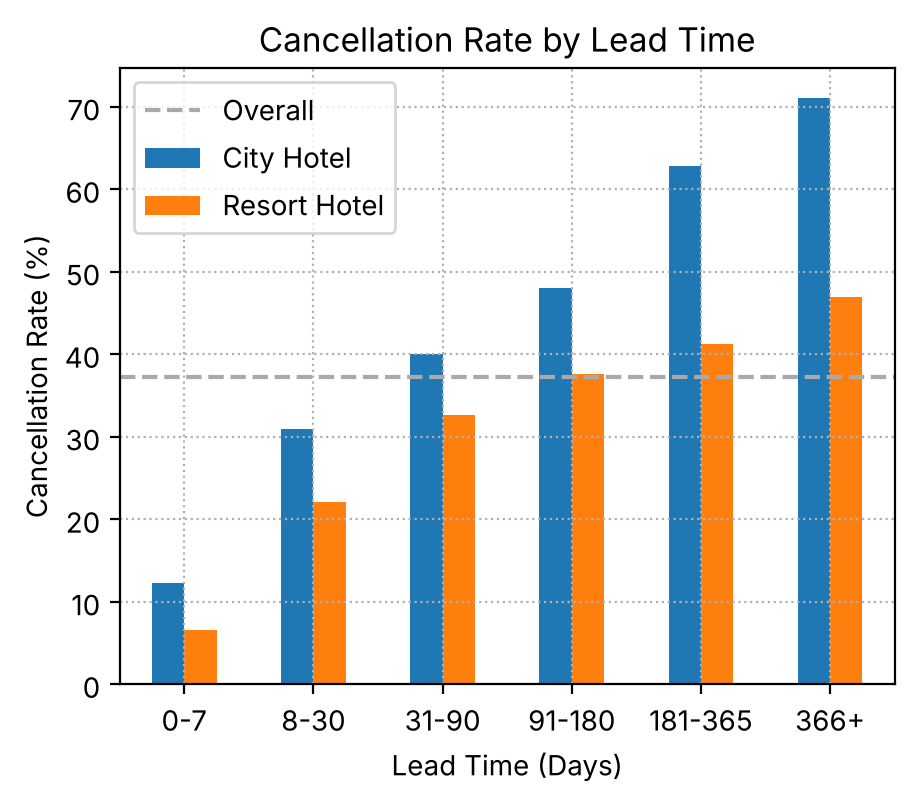
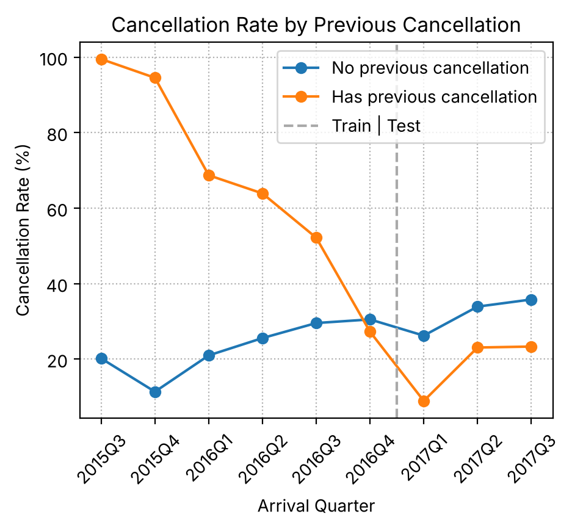
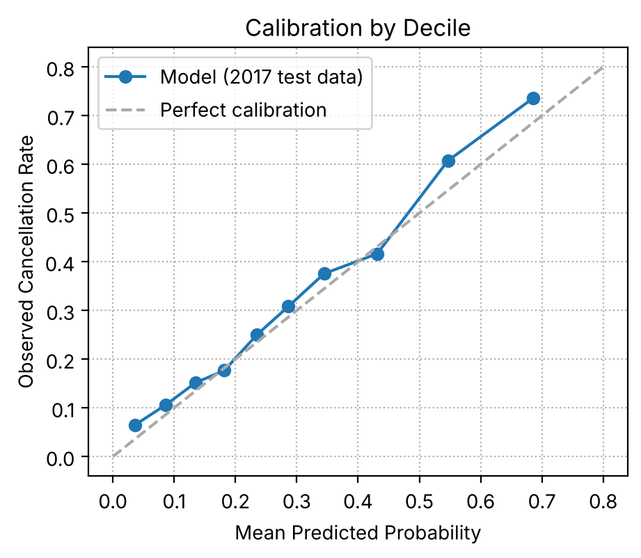
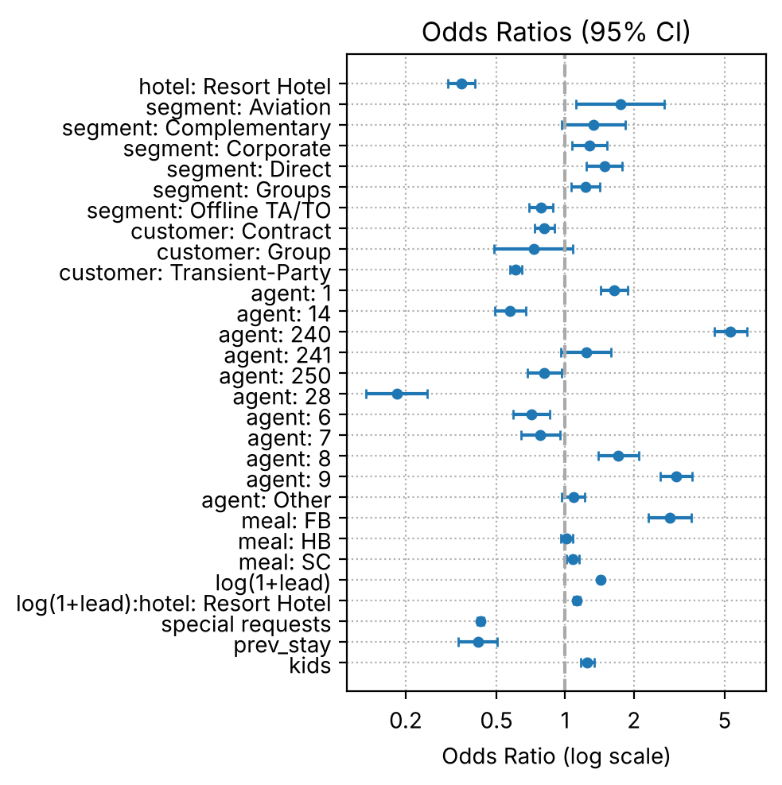
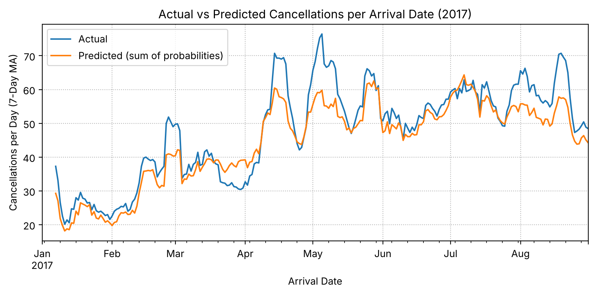

# Hotel Booking Cancellation

Can a hotel predict, at booking time, which reservations will be canceled?
This project cleans the Kaggle *Hotel Booking Demand* data and fits an interpretable
logistic regression. The model learns from 2015–2016 arrivals and is tested on 2017 arrivals.

## Data

| File | Rows × Columns | Description |
|---|---|---|
| [`data/hotels_raw.csv`](data/hotels_raw.csv) | 119,390 × 32 | Original data, unchanged |
| [`data/hotel_booking_clean.csv`](data/hotel_booking_clean.csv) | 118,540 × 30 | Output of `src/clean.py` |

- Source: [Hotel Booking Demand on Kaggle](https://www.kaggle.com/datasets/jessemostipak/hotel-booking-demand)
- Original paper: Antonio, N., de Almeida, A., & Nunes, L. (2019). [Hotel booking demand datasets](https://doi.org/10.1016/j.dib.2018.11.126). *Data in Brief*, 22, 41–49.

The data covers two hotels in Portugal, a City Hotel (Lisbon) and a Resort Hotel (Algarve),
with arrival dates from 2015-07-01 to 2017-08-31. Each row is one booking. The target is `is_canceled`.

## Repository Structure

```
Hotel-Cancellation/
├── data/
│   ├── hotels_raw.csv            # raw Kaggle data
│   └── hotel_booking_clean.csv   # cleaned data
├── src/
│   ├── explore.py                # 1. inspect the raw data
│   ├── clean.py                  # 2. clean the raw data
│   ├── visualize.py              # 3. describe the cleaned data
│   ├── features.py               # 4. model features and train/test split
│   └── model.py                  # 5. fit, compare and evaluate the model
├── figures/                      # all figures written by the scripts
├── requirements.txt
└── README.md
```

## Pipeline

Each script does one job. Run them in order from the repository root:

```
hotels_raw.csv ─► explore.py         (prints checks, fig0)
               └► clean.py ─► hotel_booking_clean.csv ─► visualize.py   (fig1–fig4)
                                                     └► features.py ─► model.py   (p2_fig1–p2_fig6)
```

| Step | Script | Input | Output |
|---|---|---|---|
| 1 | `explore.py` | raw CSV | printed checks: missing values, duplicates, outliers, leakage; `fig0` |
| 2 | `clean.py` | raw CSV | `data/hotel_booking_clean.csv` |
| 3 | `visualize.py` | clean CSV | `fig1`–`fig4` |
| 4 | `features.py` | clean CSV | `load_data()` and `split()`, used by `model.py`; run it alone to print the modeling checks and save `p2_fig1`–`p2_fig2` |
| 5 | `model.py` | `features.py` | model comparison, summary, odds ratios, test performance, `p2_fig3`–`p2_fig6` |

```bash
pip install -r requirements.txt
```

```bash
python src/explore.py
python src/clean.py
python src/visualize.py
python src/features.py
python src/model.py
```

## Method

**Cleaning (`clean.py`).** Drops 850 rows (0.71%) that are invalid or placeholders: missing
`children`, an `Undefined` segment or channel, 0 nights, 0 guests, more than 6 adults,
more than 3 children, more than 2 babies, ADR outside [0, 1000], or more than 3 parking spaces.
Builds `arrival_date` and `total_nights`, merges meal `Undefined` into `SC`, and fills missing countries with `UNK`.

**Modeling choices (`features.py`).**
- Non Refund bookings are excluded. 99.4% of them are canceled, and they are mostly duplicated group blocks.
- Leakage columns are not used: `reservation_status`, `reservation_status_date` and `assigned_room_type`
  are recorded at or after the outcome. `booking_changes` and `required_car_parking_spaces` are only known after booking.
- Lead time enters as `log(1 + lead_time)`, which has the lowest BIC of the transformations tried.
- The 10 largest agents in the training period keep their own level. All other agents are grouped as `Other`.
- Time-based split: train on 2015–2016 (67,573 rows), test on 2017 (36,381 rows).

**Model selection (`model.py`).** A term is kept only if it improves BIC on the training data
**and** does not make log loss on the 2017 test data worse. The final model is:

```
is_canceled ~ log(1 + lead_time) * hotel + market_segment + customer_type + agent_group
              + total_of_special_requests + prev_stay + kids + meal
```

## Results

| Metric (2017 test data) | Value |
|---|---|
| AUC | 0.769 |
| Log loss | 0.525 (intercept-only model: 0.633) |
| Mean predicted vs actual cancellation rate | 0.297 vs 0.319 |
| Daily cancellations: correlation with actual | 0.916 |

- **Higher cancellation odds:** longer lead time (the effect is stronger at the Resort Hotel), agent 240 (OR 5.3), agent 9 (OR 3.1), full board meal (OR 2.9).
- **Lower cancellation odds:** each special request (OR 0.43), having stayed before (OR 0.41), Resort Hotel (OR 0.35), agent 28 (OR 0.18).
- **Drift:** past cancellations predicted cancellation strongly in 2015 but not in 2017
  (cancellation rate 99.5% in 2015Q3 vs 8.9% in 2017Q1). `prev_cancel` lowers BIC but hurts test log loss, so the model leaves it out.
- **Robustness:** 26.8% of raw rows are exact duplicates. Refitting without them gives very similar coefficients.

| | |
|---|---|
|  |  |
|  |  |



## Limitations

- The 2017 data is used both to select terms and to report final performance, so the test scores are slightly optimistic.
- `total_of_special_requests` can be updated after booking, so it may carry some leakage.
- The model underestimates cancellations in 2017 because the cancellation rate rose from 26.7% (train) to 31.9% (test).
