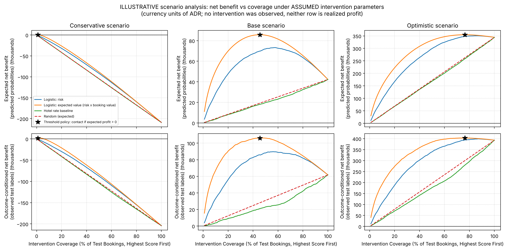

# Hotel Booking Cancellation: Risk Prediction and Decision Support


## Project Overview

- **Problem.** About one in three bookings in this data is canceled. A hotel that can estimate at booking time which reservations are likely to cancel can prioritize follow-up and judge whether retention actions are worth their cost.
- **What was built.** An interpretable logistic regression of cancellation risk, evaluated out of time against simple baselines and a gradient boosting benchmark. Its probabilities feed risk tiers and a transparent, assumption-based model of retention decisions.
- **Data and evaluation.** 119,390 bookings at two Portuguese hotels, arrivals July 2015 – August 2017 ([Kaggle](https://www.kaggle.com/datasets/jessemostipak/hotel-booking-demand)). All modeling choices are made on a validation period. The final model is evaluated once on **25,109 bookings made January–August 2017** (Non Refund bookings excluded).
- **Headline.** ROC-AUC **0.733** (95% CI 0.723–0.743) vs 0.525 for a hotel-level cancellation-rate baseline, with well-calibrated probabilities (27.3% predicted vs 28.3% observed). The 10% highest-risk bookings contain 19.4% of all cancellations.
- **What it enables.** Risk-ranked follow-up lists, risk tiers, and an expected-value rule for deciding which bookings to contact, with every economic parameter stated as an assumption.
- **Main limitation.** The data holds only final booking records. The booking date is reconstructed, so whether each feature was really known at booking time cannot be verified. The test set also only covers lead times up to 241 days.

## Key Results

**Evaluation population:** test bookings made 2017-01-01 to 2017-08-31 that are not Non Refund (n = 25,109; 28.3% canceled). Models were trained on bookings that arrived before 2017-01-01. 95% CIs come from a bootstrap that resamples arrival dates.

| Model | ROC-AUC | Average Precision | Log Loss | Brier |
|---|---|---|---|---|
| Overall cancellation rate (training) | 0.500 | 0.283 | 0.596 | 0.203 |
| Hotel-level cancellation rate (training) | 0.525 (0.515–0.535) | 0.293 | 0.595 | 0.203 |
| **Logistic regression, strict feature set (primary)** | **0.733 (0.723–0.743)** | **0.479 (0.460–0.497)** | **0.526 (0.514–0.538)** | **0.176** |
| Gradient boosting, same information (benchmark) | 0.749 (0.738–0.758) | 0.502 | 0.515 | 0.172 |
| Logistic regression, extended features (leakage-risk sensitivity) | 0.774 (0.765–0.784) | 0.579 | 0.497 | 0.162 |

- **Against the baseline:** AUC +0.209 (CI 0.198–0.219) and log loss -0.069 (CI 0.063–0.075 lower).
- **Calibration:** mean predicted probability 27.3% vs observed rate 28.3%; calibration intercept 0.05 and slope 1.01 (ideal: 0 and 1). The top two deciles are slightly under-predicted.
- **Ranking:** the top 10% of bookings by predicted risk had an observed cancellation rate of 54.7% (lift 1.94; the hotel baseline reaches 1.06) and contained 19.4% of cancellations. The top 30% contained 53.1%.
- **What the test set covers:** because the source data ends at arrival date 2017-08-31, bookings made in 2017 for later arrivals are missing. Test lead times are therefore at most 241 days (median 41; 4.5% above 180 days), against up to 709 days in training (median 65; 20.8% above 180 days). Performance on long-lead bookings is not established by this test.


## Business Decision Application

**ILLUSTRATIVE.** The data contains no retention experiments. The parameters below are assumptions, not estimates, and none of the results are realized profit.

For a booking with predicted cancellation probability *p* and room revenue *V* (ADR × nights), the expected incremental profit of one contact is

> E[profit] = *p* × *e* × (1 − *r*) × *m* × *V* − *c*

| Assumed parameter | Conservative | Base | Optimistic |
|---|---|---|---|
| *c*: cost per contact (currency units of ADR) | 10 | 5 | 3 |
| *e*: share of would-be cancellations prevented | 10% | 20% | 30% |
| *m*: contribution margin as a share of room revenue | 30% | 40% | 50% |
| *r*: probability a canceled room would have been resold anyway | 60% | 40% | 20% |

**Primary result: expected (ex-ante) values,** computed from the predicted probabilities. Base scenario, contacting the 20% of test bookings with the highest predicted risk (5,022 bookings):

| Metric | Value |
|---|---|
| Expected prevented cancellations | 495 |
| Intervention cost | 25,110 |
| Expected incremental contribution | 72,909 |
| **Expected net benefit** | **47,799** |
| Break-even effectiveness (*e* at which expected net benefit is 0) | 6.9% |

- **Conservative scenario:** the same 20% has an expected net benefit of -31,993. Effectiveness would need to be at least 27.6% to break even.
- **Optimistic scenario:** the expected net benefit is 167,205.
- **Sensitivity:** the result depends more on the assumed effectiveness and replacement probability than on the model. At *r* = 80% the Base result is roughly break-even, and at *r* = 100% every contact is a loss ([`results/business_sensitivity.csv`](results/business_sensitivity.csv)).
- **Ranking by expected value:** because *e*, *r*, *m* and *c* are the same for every booking, ranking by *p* × *V* is ranking by expected profit. At 20% coverage this yields 69,897 instead of 47,799.
- **A decision rule fixed in advance:** contact a booking if its expected profit is positive. This maximizes expected net benefit, has no tuning parameter, and was not chosen with test outcomes. Under Base assumptions it selects 28.8% of validation bookings and 45.5% of test bookings, with an expected net benefit of 85,749 on the test bookings.

**Supporting retrospective check: outcome-conditioned values.** Replacing *p* with the observed test labels, under the same assumptions, gives 55,955 for the Base 20% case, against 12,340 for random targeting of the same number of bookings. This checks the ranking after the fact. It does not show that contacts would prevent cancellations. In both the validation and the test period the outcome-conditioned values are higher than the expected values, because the highest-risk bookings canceled slightly more often than predicted.



Not modeled: displacement of other bookings, capacity and overbooking, changes in guest behavior caused by contacts, and revenue kept from deposits. Non Refund bookings are excluded from the simulation, because their deposit is kept when they cancel.

## Methodology

Details: [`docs/methodology.md`](docs/methodology.md). Audit trail: [`docs/audit.md`](docs/audit.md).

1. **Cleaning.** Nine documented rules remove 850 rows (0.71%): definition errors, group-block placeholders, 0-night day-use bookings and a few extreme values. The cancellation rate moves from 37.0% to 37.3% ([report](results/data_cleaning_report.csv)).
2. **Leakage assessment.** Outcome fields, the assigned room (set at check-in) and parking spaces (0% cancellation among 7,390 bookings with parking) are never used. Fields that can change after booking (special requests, booking changes, waiting-list days) are used only in the extended sensitivity model. Country is excluded because nationality is often confirmed at check-in. The primary model uses features **judged likely to be available at booking time**; since only final records exist, some residual leakage risk cannot be ruled out.
3. **Temporal design.** The booking date is reconstructed as arrival date minus lead time. A model in use on date T learns only from bookings that arrived before T, whose outcomes were known by then: every cancellation in the data happens on or before arrival. This is an out-of-time evaluation, not a replay of the hotel's historical system state.

   | Split | Bookings | Used for |
   |---|---|---|
   | Selection training | arrived before 2016-07-01 | fitting candidate models |
   | Validation | booked from 2016-07-01, arrived before 2017-01-01 | every modeling choice |
   | Final training | arrived before 2017-01-01 | refitting the chosen models |
   | Test | booked from 2017-01-01 | one final evaluation |

4. **Model selection.** A term enters only if it lowers training BIC **and** validation log loss. This rejected `prev_cancel`: it lowers BIC by 5,058 but raises validation log loss by 0.008, because its relationship with cancellation reverses over time ([figure](figures/07_prev_cancel_drift.png)). Category levels and the top-10 agents are learned on training data only.
5. **Evaluation.** Discrimination, probability accuracy, calibration, Top-K ranking, subgroups and daily totals against baselines, all on the test set.


## Model Evaluation and Interpretation

**Why AUC is lower than in the original project (0.769).** Evaluation population, prediction-time assumptions, feature set and selection procedure all changed. The new code reproduces the original number exactly and separates the effects:

| Model | Test set | AUC | Log loss |
|---|---|---|---|
| Original specification (selected using its own test set) | 2017 arrivals (original definition) | 0.769 | 0.525 |
| Original specification | bookings made from 2017 | 0.765 | 0.503 |
| Strict model + special requests | bookings made from 2017 | 0.767 | 0.503 |
| **Strict model** | bookings made from 2017 | **0.733** | **0.526** |

Almost the whole difference comes from leaving out `total_of_special_requests`, a feature that may be recorded after booking. A lower AUC does not show that the strict model is better. The strict model gives up some apparent discrimination so that it depends less on information whose availability at prediction time is uncertain.

**Gradient boosting.** It was worse than the strict logistic model on validation (log loss 0.534 vs 0.515) but better on test (AUC +0.015, CI 0.011–0.020). The logistic model was retained as the primary model because of its validation performance, its interpretability and the project's explanatory goals. Selection was not revisited after seeing test results. The test gap shows that the boosting model can capture structure the logistic model misses, and that model rankings were not stable across these two periods.

**Conditional associations.** These are odds ratios from the strict model with the other variables held fixed; they are not causal effects. Only coefficients that keep their sign and move by at most 0.2 on the log-odds scale when exact duplicates are removed are reported as robust ([`results/dedup_coefficients.csv`](results/dedup_coefficients.csv)).
- **Robust:**
  - Longer lead time is associated with higher cancellation odds (OR 1.39 per unit of log(1 + days) at the City Hotel).
  - The Resort Hotel has lower odds than the City Hotel, but the gap narrows with lead time: OR 0.38 at 0 days, 0.53 at 30 days, 0.64 at 180 days. The single "Resort" coefficient is only the effect at lead time 0.
  - Earlier completed stays (OR 0.36), Contract customers (OR 0.63) and the direct distribution channel (OR 0.60) are associated with lower odds.
  - Agent 240 (OR 2.2 vs no agent), the Corporate segment (OR 2.3 vs Online TA) and children or babies (OR 1.14) are associated with higher odds.
- **Not robust** (they change substantially without duplicates): company ID (OR 0.31), full board (OR 2.7), the Groups segment, Transient-Party customers and most individual agents. Their predictive contribution is real in this sample, but their size should not be read as a stable business insight.


**Subgroups.**
- Discrimination is better for the Resort Hotel (AUC 0.78) than the City Hotel (0.71), and weakest for bookings made 0–7 days ahead (0.60).
- The Resort Hotel is under-predicted (20.3% predicted vs 25.5% observed), and Transient-Party bookings are over-predicted (19.4% vs 13.9%).
- Small groups are flagged as unstable ([figure](figures/14_subgroup_performance.png)).

**Daily totals.** Summing the probabilities per arrival date gives MAE 4.4 cancellations per day, against 7.4 for a hotel-rate × booking-count baseline. The baseline already reaches a correlation of 0.88 from booking volume alone, so the error reduction, not the model's 0.94 correlation, is the relevant comparison. This groups a fixed set of test bookings after the fact; it is not a forecast made in advance ([figure](figures/15_daily_cancellations.png)).

**Uncertainty.** The bootstrap resamples arrival dates, which accounts for correlation among bookings arriving on the same day (for example group blocks). It does not account for repeated guests, agent-level dependence or dependence between adjacent dates, so the CIs are likely somewhat too narrow.

## Reproducibility

Python 3.11 or newer. The data is included in [`data/`](data); its source is [Kaggle](https://www.kaggle.com/datasets/jessemostipak/hotel-booking-demand).

```bash
git clone https://github.com/shuaixia117/Hotel-Cancellation.git
```

```bash
cd Hotel-Cancellation
```

```bash
pip install -r requirements-dev.txt
```

```bash
pip install -e . --no-deps
```

Full pipeline (about 1.5 minutes; it works from any directory after installation):

```bash
python -m src.run_pipeline
```

Quicker run with fewer bootstrap replicates:

```bash
python -m src.run_pipeline --n-boot 50
```

Tests and linter:

```bash
pytest
```

```bash
ruff check src tests
```

Raw-data exploration report:

```bash
python -m src.explore
```

**Outputs.**
- [`results/`](results): machine-readable tables, for example `model_comparison_ci.csv`, `test_metrics.json`, `topk_metrics.csv`, `risk_tiers.csv`, `business_scenarios.csv`, `business_policy.csv` and `model_selection.csv`.
- [`figures/`](figures): all figures.

**Business assumptions.** Edit `SCENARIOS` and `COVERAGE_GRID` in [`src/config.py`](src/config.py), then rerun the pipeline. Split dates, feature sets and the bootstrap size are set in the same file.

## Repository Structure

```
Hotel-Cancellation/
├── .github/workflows/tests.yml   # CI: lint, unit tests, pipeline smoke test
├── data/                         # raw and cleaned CSV
├── docs/                         # audit, methodology, data dictionary, limitations
├── figures/                      # all figures (generated)
├── results/                      # all result tables (generated)
├── src/
│   ├── config.py                 # paths, split dates, feature sets, scenarios
│   ├── clean.py                  # cleaning rules and cleaning report
│   ├── explore.py                # raw-data checks behind the cleaning and leakage decisions
│   ├── features.py               # derived features, temporal splits, training-only encoder
│   ├── model.py                  # logistic selection, baselines, boosting, interaction effects
│   ├── evaluate.py               # metrics, bootstrap, calibration, Top-K, subgroups, daily totals
│   ├── business.py               # risk tiers, expected-value decisions, scenarios
│   ├── visualize.py              # figures
│   └── run_pipeline.py           # single entry point
├── tests/                        # pytest suite
├── pyproject.toml
├── requirements.txt
└── requirements-dev.txt
```

## Limitations

Details: [`docs/limitations.md`](docs/limitations.md).
- **Scope.** Two hotels, 2015–2017; results may not transfer to other hotels or later years.
- **Feature availability.** Only final booking records exist and the booking date is reconstructed. Feature availability at booking time is a judgment, and the test set only covers lead times up to 241 days.
- **Dependence.** There is no booking ID, 26.9% of rows are exact duplicates, and there are group bookings. Some coefficients are not robust, and the CIs are likely somewhat narrow.
- **Non Refund bookings** are handled by a rule; their pattern suggests a data or process artifact.
- **Interpretation.** Coefficients are associations, not causal effects. Intervention effects are assumptions, not observations.
- **Model ranking.** Validation and test cover different seasons; the ranking of logistic regression and boosting differed between them.
