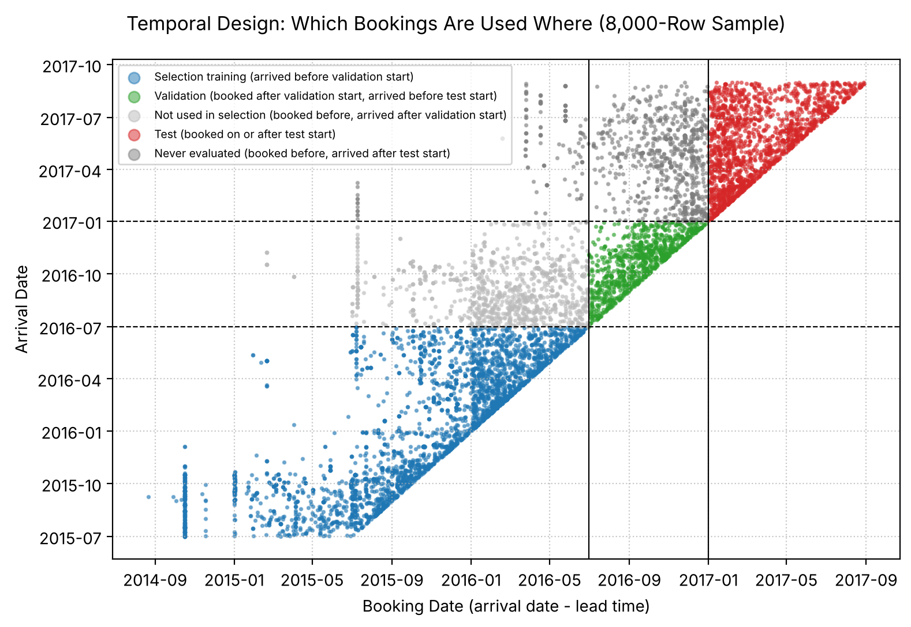
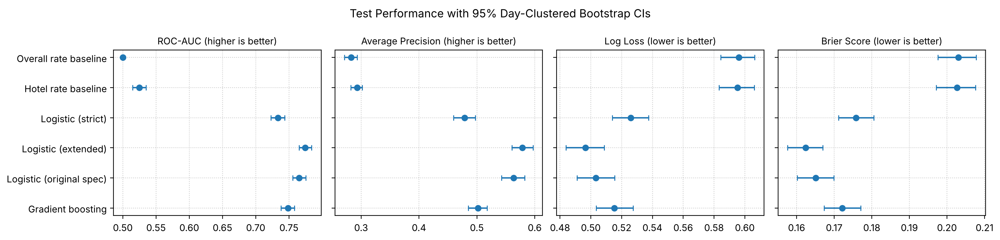

# Hotel Booking Cancellation: Risk Prediction and Decision Support


An interpretable model that estimates, at booking time, how likely a hotel reservation is to be canceled. The model is evaluated out of time on later bookings, and its probabilities are turned into risk-based follow-up decisions with a transparent, assumption-based economic model.

| | |
|---|---|
| **Data** | 119,390 bookings, two Portuguese hotels, arrivals July 2015 – August 2017 |
| **Primary model** | Logistic regression with booking-time features, selected on a validation period |
| **Test set** | 25,109 bookings made January–August 2017 (Non Refund excluded), evaluated once |
| **ROC-AUC** | **0.733** (95% CI 0.723–0.743) vs 0.525 for a hotel-level cancellation-rate baseline |
| **Calibration** | 27.3% predicted vs 28.3% observed cancellation rate; calibration slope 1.01 |
| **Ranking** | the 10% highest-risk bookings contain 19.4% of all cancellations (lift 1.94) |
| **Main limitation** | only final booking records exist, so feature availability at booking time is a judgment |

## 1. Business Problem

About one in three bookings in this data is canceled. Cancellations leave rooms empty when it is too late to resell them, and they make demand harder to plan. If a hotel can estimate each booking's cancellation risk when the booking is made, it can:
- prioritize which guests to contact,
- plan inventory with expected rather than nominal bookings,
- judge whether a retention action is worth its cost.

The project answers four questions:
1. Which reservations are most likely to be canceled?
2. How reliable and interpretable are the predicted probabilities?
3. How much does the model add over simple baselines?
4. How can the predictions support operational decisions?

## 2. Data and Processing

- **Source:** [Hotel Booking Demand on Kaggle](https://www.kaggle.com/datasets/jessemostipak/hotel-booking-demand), from Antonio, de Almeida & Nunes (2019), [*Data in Brief* 22, 41–49](https://doi.org/10.1016/j.dib.2018.11.126).
- **Coverage:** a City Hotel (Lisbon, 66% of bookings) and a Resort Hotel (Algarve, 34%). One row per booking, with 32 fields covering timing, stay, guests, channel, price, history and outcome. Definitions: [`docs/data_dictionary.md`](docs/data_dictionary.md).
- **Files:** raw data in [`data/hotels_raw.csv`](data/hotels_raw.csv) (119,390 rows); cleaned data in [`data/hotel_booking_clean.csv`](data/hotel_booking_clean.csv) (118,540 rows).
- **Cleaning:** nine documented rules remove 850 rows (0.71%). They cover:
  - definition errors, such as missing children counts and an ADR of -6.38 or 5,400;
  - group-block placeholders with 10–55 adults, all canceled at ADR 0;
  - 0-night day-use bookings;
  - a few extreme values.

  The exploration behind these rules is in `src/explore.py` ([figure](figures/00_raw_distributions.png)). Each rule's count and the cancellation rate of the removed rows are in [`results/data_cleaning_report.csv`](results/data_cleaning_report.csv). Cleaning moves the overall cancellation rate only from 37.0% to 37.3%.
- **Non Refund bookings** (12%) cancel 99.4% of the time and are mostly group blocks. They are scored by a simple rule (their training cancellation rate), and the logistic model covers all other bookings. A single model with `deposit_type` performed the same on validation. The segmented scheme was chosen because it keeps the interpretable model free of the group-block pattern, and because a canceled Non Refund booking keeps its deposit anyway.
- **Duplicates:** 26.9% of rows are exact copies of another row, and there is no booking ID, so they cannot be told apart from identical bookings by different guests. They are kept, and removing them is run as a robustness check.

## 3. Why Interpretable Logistic Regression

The goal is decision support, not only ranking.
- A logistic model gives probabilities that can be checked for calibration and used directly in expected-value calculations.
- Its coefficients show *which* booking characteristics are associated with risk, and its structure is easy to audit and explain to revenue managers.
- Gradient boosting with the same booking-time information is reported as a benchmark. It was worse on the validation period (log loss 0.534 vs 0.515) but better on the test period (AUC 0.749 vs 0.733). The logistic model was kept as the primary model on the basis of its validation performance and interpretability, and that choice was not revisited after the test evaluation. The test gap shows that a more flexible model can add some discrimination, and that the ranking of the two models was not stable across periods.

## 4. Leakage Control and Temporal Validation

**Feature availability.** Each field was assessed for whether it is likely known when a booking is made ([audit table](docs/methodology.md#2-feature-availability-audit)).
- **Never used:** outcome fields; the assigned room, which is set at check-in; parking spaces (0% cancellation among 7,390 bookings with parking, so recorded at arrival).
- **Extended sensitivity model only:** fields that can change after booking (special requests, booking changes, waiting-list days).
- **Excluded:** country, because nationality is often confirmed at check-in.

The primary model uses features **judged likely to be available at booking time**. Because only final records exist, some residual leakage risk cannot be ruled out.

**Temporal design.** The booking date is reconstructed as arrival date minus lead time. A model in use on date T can only learn from bookings whose outcome was known by T, which means bookings that arrived before T: every cancellation in the data happens on or before arrival.

| Split | Bookings | Used for |
|---|---|---|
| Selection training | arrived before 2016-07-01 | fitting candidate models |
| Validation | booked from 2016-07-01, arrived before 2017-01-01 | every modeling choice |
| Final training | arrived before 2017-01-01 | refitting the chosen models |
| Test | booked from 2017-01-01 | one final evaluation |



**Model selection.**
- A candidate term enters only if it lowers training BIC **and** validation log loss.
- Category levels and the top-10 travel agents are learned on training data only.
- The rule rejected a previous-cancellation flag: it improves in-sample fit strongly (BIC -5,058) but raises validation log loss by 0.008, because its relationship with cancellation reverses over time ([figure](figures/07_prev_cancel_drift.png)).
- **Final terms:** `log(1 + lead time) × hotel`, market segment, customer type, agent group, prior completed stay, children, meal plan, company ID and distribution channel.

This is an out-of-time evaluation, not a replay of the hotel's historical system state. Details: [`docs/methodology.md`](docs/methodology.md).

## 5. Predictive Performance

**Evaluation population:** test bookings made 2017-01-01 to 2017-08-31, excluding Non Refund (n = 25,109; 28.3% canceled). 95% CIs come from 500 bootstrap replicates that resample arrival dates.

| Model | ROC-AUC | Average Precision | Log Loss | Brier |
|---|---|---|---|---|
| Overall cancellation rate (training) | 0.500 | 0.283 | 0.596 | 0.203 |
| Hotel-level cancellation rate (training) | 0.525 (0.515–0.535) | 0.293 | 0.595 | 0.203 |
| **Logistic regression (primary)** | **0.733 (0.723–0.743)** | **0.479 (0.460–0.497)** | **0.526 (0.514–0.538)** | **0.176** |
| Gradient boosting (benchmark) | 0.749 (0.738–0.758) | 0.502 | 0.515 | 0.172 |
| Logistic regression, extended features (sensitivity) | 0.774 (0.765–0.784) | 0.579 | 0.497 | 0.162 |



- **Against the hotel baseline:** AUC +0.209 (CI 0.198–0.219); log loss 0.069 lower (CI 0.063–0.075).
- **Extended features:** they add 0.041 AUC. Part of that information may only be recorded after booking, so this is an upper bound, not an achievable gain at booking time.
- **Calibration:** mean predicted probability 27.3% vs observed rate 28.3%; calibration intercept 0.05 and slope 1.01 (ideal: 0 and 1). The top two deciles are slightly under-predicted ([figure](figures/10_calibration.png)).
- **Ranking (Top-K):**

  | Highest-risk share of bookings | Observed cancellation rate | Share of all cancellations | Lift | Lift of hotel baseline |
  |---|---|---|---|---|
  | 5% | 55.5% | 9.8% | 1.96 | 1.03 |
  | 10% | 54.7% | 19.4% | 1.94 | 1.06 |
  | 20% | 51.8% | 36.6% | 1.83 | 1.08 |
  | 30% | 50.0% | 53.1% | 1.77 | 1.07 |

- **Subgroups:**
  - AUC is 0.78 for the Resort Hotel and 0.71 for the City Hotel, and lowest (0.60) for bookings made 0–7 days ahead.
  - The Resort Hotel is under-predicted (20.3% predicted vs 25.5% observed), and Transient-Party bookings are over-predicted (19.4% vs 13.9%).
  - Small groups are flagged as unstable ([figure](figures/14_subgroup_performance.png)).
- **Daily totals:** summing probabilities per arrival date gives MAE 4.4 cancellations per day vs 7.4 for a hotel-rate × booking-count baseline. The baseline already correlates 0.88 with actual totals through booking volume alone, so the error reduction is the relevant comparison. This is a grouping of the test bookings after the fact, not a forecast made in advance ([figure](figures/15_daily_cancellations.png)).
- **Test coverage:** the source data ends at arrival date 2017-08-31, so test lead times are at most 241 days (median 41; 4.5% above 180 days), against up to 709 days in training. Performance on long-lead bookings is not established.

## 6. What Is Associated with Cancellation Risk

These are conditional odds ratios (OR) from the primary model, holding the other variables fixed. They describe associations, not causal effects. Only coefficients that keep their sign and change by at most 0.2 on the log-odds scale when exact duplicates are removed are reported as robust ([`results/dedup_coefficients.csv`](results/dedup_coefficients.csv)).

- **Lead time** is the strongest factor: odds rise with log(1 + days ahead) (OR 1.39 per unit at the City Hotel).
- **Hotel depends on lead time:** the Resort Hotel has lower odds than the City Hotel, but the gap narrows as lead time grows: OR 0.38 at 0 days, 0.53 at 30 days, 0.64 at 180 days.
- **Lower risk:** guests with earlier completed stays (OR 0.36), Contract customers (OR 0.63), the direct distribution channel (OR 0.60).
- **Higher risk:** agent 240 (OR 2.2 vs no agent), the Corporate segment (OR 2.3 vs Online TA, controlling for channel and customer type), bookings with children or babies (OR 1.14).
- **Not robust:** company ID (OR 0.31), full board (OR 2.7), the Groups segment, Transient-Party customers and most individual agents are predictive in this sample, but their size changes substantially without duplicates.


## 7. Decision Support

**Risk tiers.** Cut points are set at the 50th and 80th percentiles of predicted risk in the training data and applied unchanged to the test bookings:

| Tier | Share of test bookings | Mean predicted probability | Observed cancellation rate | Share of cancellations |
|---|---|---|---|---|
| Low | 46.7% | 12.8% | 13.0% | 21.4% |
| Medium | 29.5% | 33.3% | 34.0% | 35.4% |
| High | 23.8% | 48.3% | 51.2% | 43.1% |

**Retention economics (ILLUSTRATIVE).** The data contains no retention experiments. The parameters below are assumptions, not estimates, and the results are not realized profit.

For a booking with predicted cancellation probability *p* and room revenue *V* (ADR × nights), the expected incremental profit of one contact is

> E[profit] = *p* × *e* × (1 − *r*) × *m* × *V* − *c*

| Assumed parameter | Conservative | Base | Optimistic |
|---|---|---|---|
| *c*: cost per contact (currency units of ADR) | 10 | 5 | 3 |
| *e*: share of would-be cancellations prevented | 10% | 20% | 30% |
| *m*: contribution margin as a share of room revenue | 30% | 40% | 50% |
| *r*: probability a canceled room would have been resold anyway | 60% | 40% | 20% |

**Expected (ex-ante) values,** from the predicted probabilities. Base scenario, contacting the 20% of test bookings with the highest predicted risk (5,022 bookings):

| Metric | Value |
|---|---|
| Expected prevented cancellations | 495 |
| Intervention cost | 25,110 |
| Expected incremental contribution | 72,909 |
| **Expected net benefit** | **47,799** |
| Break-even effectiveness | 6.9% |

- **Other scenarios:** the same 20% has an expected net benefit of -31,993 in the Conservative scenario (break-even effectiveness 27.6%) and 167,205 in the Optimistic one.
- **Sensitivity:** the decision depends more on the assumed effectiveness and replacement probability than on the model. At *r* = 80% the Base case is roughly break-even ([`results/business_sensitivity.csv`](results/business_sensitivity.csv)).
- **Ranking by expected value:** because *e*, *r*, *m* and *c* are the same for every booking, ranking by *p* × *V* is ranking by expected profit. At 20% coverage this gives 69,897.
- **Decision rule:** contact a booking if its expected profit is positive. The rule maximizes expected net benefit, has no tuning parameter and uses no test outcomes. Under Base assumptions it selects 28.8% of validation bookings and 45.5% of test bookings (expected net benefit 85,749 on the test bookings) ([`results/business_policy.csv`](results/business_policy.csv)).
- **Retrospective check:** using the observed test labels under the same assumptions, the Base top-20% case gives an outcome-conditioned value of 55,955, against 12,340 for randomly chosen bookings. This confirms the ranking; it does not show that contacts would prevent cancellations.


Not modeled: displacement of other bookings, capacity and overbooking, behavioral changes caused by contacts, and revenue kept from deposits. Non Refund bookings are excluded from the simulation. Details: [`docs/methodology.md`](docs/methodology.md#8-business-simulation).

## 8. Limitations

Full list: [`docs/limitations.md`](docs/limitations.md).
- **Scope.** Two hotels, 2015–2017; results may not transfer to other hotels or later years.
- **Feature availability.** Only final booking records exist and the booking date is reconstructed, so feature availability at booking time is a judgment. The test set covers lead times up to 241 days.
- **Dependence.** There is no booking ID; duplicates and group bookings make rows dependent. Some coefficients are not robust, and the bootstrap CIs, which only account for same-day dependence, are likely somewhat narrow.
- **Validation design.** One validation period, with a different season mix from the test period.
- **Interpretation.** Coefficients are associations, not causal effects. Intervention effects are assumptions, not observations.

## Reproduction

Python 3.11 or newer. The data is included in [`data/`](data).

```bash
git clone https://github.com/shuaixia117/Hotel-Cancellation.git
```

```bash
cd Hotel-Cancellation
```

```bash
pip install -r requirements-dev.txt
```

```bash
pip install -e . --no-deps
```

Full pipeline (about 1.5 minutes; it regenerates everything in `results/` and `figures/` and works from any directory after installation):

```bash
python -m src.run_pipeline
```

Quicker run with fewer bootstrap replicates:

```bash
python -m src.run_pipeline --n-boot 50
```

Tests and linter:

```bash
pytest
```

```bash
ruff check src tests
```

Raw-data exploration report (prints the checks behind the cleaning and leakage decisions and writes `figures/00_raw_distributions.png`):

```bash
python -m src.explore
```

Business assumptions, split dates, feature sets and the bootstrap size are set in [`src/config.py`](src/config.py).

## Repository Structure

```
Hotel-Cancellation/
├── .github/workflows/tests.yml   # CI: lint, unit tests, pipeline smoke test
├── data/                         # raw and cleaned CSV
├── docs/                         # methodology, data dictionary, limitations
├── figures/                      # all figures (generated)
├── results/                      # all result tables (generated)
├── src/
│   ├── config.py                 # paths, split dates, feature sets, scenarios
│   ├── clean.py                  # cleaning rules and cleaning report
│   ├── explore.py                # raw-data checks behind the cleaning and leakage decisions
│   ├── features.py               # derived features, temporal splits, training-only encoder
│   ├── model.py                  # logistic selection, baselines, boosting, interaction effects
│   ├── evaluate.py               # metrics, bootstrap, calibration, Top-K, subgroups, daily totals
│   ├── business.py               # risk tiers, expected-value decisions, scenarios
│   ├── visualize.py              # figures
│   └── run_pipeline.py           # single entry point
├── tests/                        # pytest suite
├── pyproject.toml
├── requirements.txt
└── requirements-dev.txt
```
