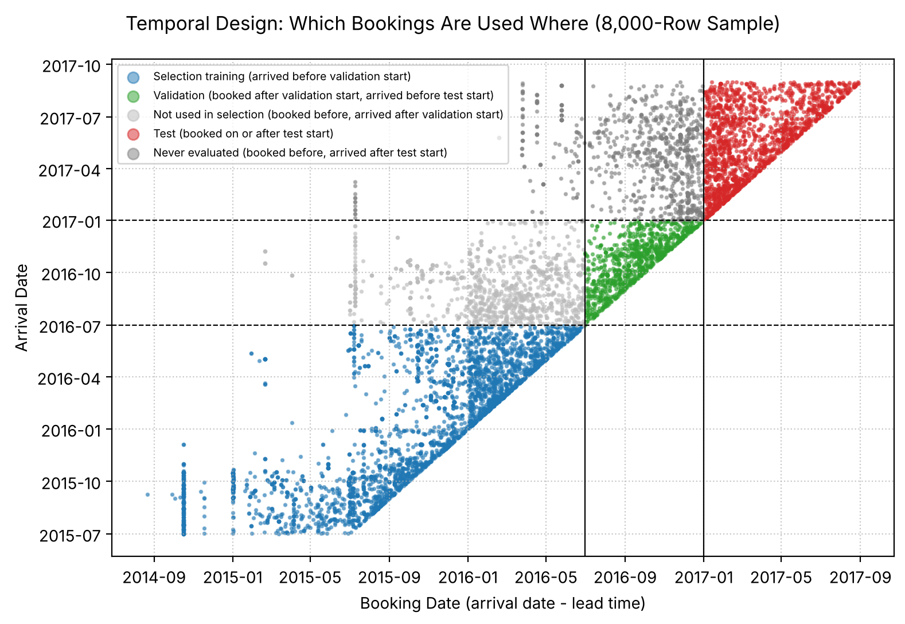

# Methodology

All numbers in this document come from `results/` and are regenerated by `python -m src.run_pipeline`.

## 1. Prediction time and temporal design

**Use case.** A hotel scores each reservation **on the day it is booked**, using information judged likely to be
available then. The model in use on a given date can only have been trained on bookings whose outcome was already known
on that date. The public data holds final booking records rather than historical snapshots, so the feature values that
existed at booking time cannot be verified; the design reduces leakage risk but cannot eliminate it.

**Booking date.** The data has no booking time stamp. It is reconstructed from the field definitions as
`booking_date = arrival_date - lead_time` (days). This is a reconstruction, not an original record; if a booking's arrival
date was changed after booking, the reconstruction can be off. The result is plausible: booking dates run from 2014-03-18
to 2017-08-31 and never fall after the arrival date.

**When is an outcome known?** Every cancellation in the data has `reservation_status_date` on or before the arrival date
(checked in `tests/test_clean.py`). A booking that is not canceled is known to be "not canceled" once the guest arrives.
So **a booking's outcome is known by its arrival date at the latest**, and the training set for a model used from date T
is "bookings that arrived before T". Canceled bookings with a later arrival date are known earlier, but adding only those
would over-represent cancellations, so they are left out.

The data only records the final status of each booking, not its history. The design therefore does not simulate what the
hotel's system looked like on each day (for example, special requests added later are already in the record).
It is an out-of-time evaluation with a strict cutoff rule, not a full point-in-time replay.

**Splits** (`src/features.py`, boundaries in `src/config.py`):

| Split | Rule | Rows (incl. Non Refund) | Purpose |
|---|---|---|---|
| Selection training | arrived before 2016-07-01 | 48,726 | fit candidate models |
| Validation | booked from 2016-07-01, arrived before 2017-01-01 | 14,320 | choose terms, Non Refund scheme, boosting settings |
| Final training | arrived before 2017-01-01 | 78,033 | refit the chosen models |
| **Test** | **booked from 2017-01-01** (arrivals up to 2017-08-31) | 26,408 | one final evaluation |

Why these dates:
- The selection training window covers 12 full months (July 2015 – June 2016), so every arrival month appears once.
- The test window (bookings made from January 2017) is the latest period that can be evaluated.
- Bookings made before a cutoff that arrive after it ("in flight") are excluded from that stage's training and evaluation,
  because their outcome was unknown at the cutoff and they were made before it.

**Implementation checks** (`trained_window`, `booked_window`, `make_splits` in `src/features.py`; `check_splits` in
`src/run_pipeline.py`; tests in `tests/test_features.py`): selection training rows all arrived before 2016-07-01; validation rows
were booked on or after that date (so they cannot overlap selection training) and arrived before 2017-01-01; final training rows
arrived before 2017-01-01; test rows were booked on or after 2017-01-01; every encoder is fitted on the matching training rows;
model selection receives only training and validation rows.

**Consequences that must be kept in mind:**
- The data was selected by **arrival date** (up to 2017-08-31). Bookings made in 2017 for later arrivals are missing, so
  the test set is limited to lead times of at most 241 days (median 41 days; 4.5% above 180 days), while the final training
  data reaches 709 days (median 65; 20.8% above 180 days). Validation is limited to 177 days (median 25). This is a selection
  effect of arrival-date truncation: the evaluated population over-represents short lead times, and performance on long-lead
  bookings is not established. Lead-time subgroup results are reported separately (`results/split_summary.csv`).
- Validation arrivals are in July–December, test arrivals in January–August, so seasonality differs between the two.
- With 26 months of data there is room for only one validation window with a full year of training data, so
  rolling-origin validation with several folds was not possible without very short training or validation windows.

## 2. Feature availability audit

"Available at booking?" is an assessment, not a fact: the public data does not document when each field was recorded.

| Feature | Available at booking? | Leakage risk | Decision | Reason |
|---|---|---|---|---|
| `reservation_status`, `reservation_status_date` | No | Certain | Never used | They are the outcome |
| `assigned_room_type` | No | Certain | Never used | Assigned at check-in; 5% cancellation when it differs from the reserved room |
| `required_car_parking_spaces` | No | Certain | Never used | 0% cancellation in all 7,390 bookings with parking: recorded at arrival |
| `country` | Doubtful | High | Not used | Nationality is often confirmed at check-in; missing country cancels at 12% vs 37% |
| `booking_changes` | Partly | High | Extended set only | Counts changes until arrival or cancellation |
| `total_of_special_requests` | Partly | Medium–high | Extended set only | Requests can be added after booking; 48% cancellation with none vs about 22% with any |
| `days_in_waiting_list` | Partly | Medium | Extended set only | Known when the booking is confirmed, which can be after the request |
| `previous_cancellations`, `previous_bookings_not_canceled` | Probably | Medium | Candidates (`prev_cancel`, `prev_stay`) | Unclear whether counted as of booking; the `prev_cancel` effect reverses over time |
| `is_repeated_guest` | Probably | Low–medium | Candidate | Same question as above |
| `adr` | Probably | Medium | Candidate | For stays, ADR may reflect final charges |
| `deposit_type` | Yes | Low | Defines the Non Refund segment | Chosen at booking |
| `reserved_room_type`, `meal`, `adults`, `children`, `babies`, nights | Yes, but can be modified | Low | Base terms or candidates | Values may reflect later changes |
| `agent`, `company`, `market_segment`, `distribution_channel`, `customer_type` | Yes | Low | Base terms or candidates | Set when the booking is made |
| `hotel`, `lead_time`, arrival month | Yes | Low | Base terms or candidates | Part of the booking itself |

**Feature sets** (`src/config.py`):
- **Strict** (primary): base terms `log1p(lead_time) * hotel + market_segment + customer_type + agent_group + prev_stay + kids + meal`,
  plus candidates chosen by the selection rule (`prev_cancel`, `is_repeated_guest`, `C(month)`, `distribution_channel`,
  `reserved_room_type`, `log1p(adr)`, `adults`, `log1p(total_nights)`, `weekend_share`, `has_company_id`, a quadratic lead-time term).
- **Extended** (sensitivity only): strict + `total_of_special_requests` + `log1p(booking_changes)` + `log1p(days_in_waiting_list)`.
- The leakage columns are blocked by a test (`tests/test_features.py`).

## 3. Encoding and feature engineering

- `log1p(lead_time)`: lowest training BIC of the transformations tried; the empirical log-odds is close to linear in it, with different slopes per hotel (`figures/06_logodds_vs_lead_time.png`).
- `agent_group`: the 10 agents with most bookings **in the training window** keep their own level; other agents become `Other`; no agent is `None` (reference).
- Every categorical column: levels are learned on the training window; levels with fewer than 30 training rows and levels never seen in training map to `Other`.
  If a column has no rare training levels, there is no `Other` level, and an unseen value falls back to the **reference level**.
  An empty `Other` level is not added, because a level with no training rows is an all-zero, unidentifiable column.
  For every such column the reference level is also the most frequent training level, so the fallback is a mode imputation.
  It is not a neutral "unknown" estimate. In this data it is never triggered: no validation or test row has an
  unseen level (`results/encoding_fallbacks.csv`, checked by a test). New categories in future data should be reviewed rather than
  silently scored.
- Reference levels: City Hotel, Online TA, TA/TO, Transient, no agent, BB, room A, No Deposit.
- Missing values: `agent` and `company` missing means "none" (coded as a level or as `has_company_id = 0`); `country` is not used. Missing `children` (4 rows) is removed in cleaning.

## 4. Model selection

Starting from the base terms, greedy forward selection adds the candidate that lowers validation log loss most, among
candidates that lower training BIC **and** validation log loss. The test set plays no role. A backward pass then drops a term only if both criteria improve.
Every fit is logged in `results/model_selection.csv`.

Result: `has_company_id` and `distribution_channel` were added. Notable rejections:

| Candidate | Training ΔBIC | Validation Δ log loss | Reading |
|---|---|---|---|
| `prev_cancel` | -5,058 | +0.0079 | Very strong in-sample, harmful out of time: the effect drifts |
| `C(month)` | -255 | +0.0070 | Month effects of one year do not carry over |
| `is_repeated_guest` | -399 | +0.0027 | Same pattern |
| Quadratic lead time | +9.7 | -0.0003 | Small out-of-time gain, not supported by BIC |

The `lead_time × hotel` interaction stays: dropping it raises BIC by 8.3 even though validation log loss improves by 0.0003.
Its support is therefore mainly in-sample; it is kept because it also matches the empirical log-odds plot.
Statistical significance alone was not used to keep any term.

**Gradient boosting** (benchmark only): `HistGradientBoostingClassifier` on the same booking-time columns that the strict
logistic model could choose from, with native categorical handling. A 15-setting grid was compared on validation;
the best was learning rate 0.05 with 4 leaves per tree (an interior point of the grid).

## 5. Non Refund bookings

Non Refund bookings (12% of cleaned bookings) cancel 99.4% of the time. They are mostly group blocks
(in the raw data: 97% Groups or Offline TA/TO, 97% country PRT, 98% part of duplicated rows).

| Scheme | Coverage | Validation log loss (all bookings) | Notes |
|---|---|---|---|
| A: one logistic model with `deposit_type` | 100% | 0.5087 | Non Refund rows also shape the other coefficients |
| B: logistic model without Non Refund | 98.9% (validation), 95.1% (test) | — | Leaves Non Refund bookings unscored |
| **C: Non Refund rule + logistic model** | 100% | 0.5100 | Non Refund bookings get their training cancellation rate (99.2%) |

A and C differ by 0.0013 in validation log loss, which is within normal noise (the test CI half-width is about 0.012), and
their non Non Refund predictions are nearly identical. **C is used**: it covers every booking, keeps the interpretable
model free of the group-block pattern, and fits the business logic: the deposit of a canceled Non Refund booking is kept,
so retention actions are not aimed at them. Business simulations therefore use non Non Refund bookings only.
The test-set comparison is in `results/nonrefund_schemes.csv` and confirms that the schemes are equivalent (both 0.502).

## 6. Duplicates

31,926 cleaned rows (26.9%) are exact copies of an earlier row. Without a booking ID, it is not possible to tell double entries
from different guests with identical bookings (for example rooms of one group). They are **kept**, and deduplication is a
robustness check (`results/dedup_*.csv`):
- Predictions are robust: test AUC 0.733 (all rows) vs 0.735 (deduplicated), log loss 0.526 vs 0.526.
- Mean predicted probability drops from 0.273 to 0.258 (actual 0.283), because duplicates are mostly canceled.
- Several coefficients change a lot (for example `has_company_id` -1.19 → -0.66, agent 6 -0.91 → -0.21, meal FB 1.01 → 0.52).
- Pre-declared rule: a coefficient is **robust** if it keeps its sign and moves by at most 0.2 on the log-odds scale
  (`robust_to_dedup` in `results/dedup_coefficients.csv`).
  - Robust: lead time and its hotel interaction, hotel, `prev_stay`, kids, Corporate and Direct segments, Contract customers, agent 240, the Direct channel.
  - Not robust: company ID, full board, Groups and Offline TA/TO segments, Transient-Party customers, agents 6, 7, 8, 9 and 28.
  The README only reports robust coefficients as business insights.

## 7. Evaluation

Primary evaluation population: test bookings that are not Non Refund (25,109 rows, cancellation rate 28.3%).
- **Discrimination**: ROC-AUC, Average Precision.
- **Probability accuracy**: log loss, Brier score.
- **Calibration**: mean predicted vs actual rate, calibration intercept (logit offset model; 0 is ideal) and slope (1 is ideal), deciles.
- **Uncertainty**: 500 bootstrap replicates that resample whole arrival dates, because bookings on one date are correlated. CIs of differences against the strict model are computed on the same replicates.
  The scheme handles same-day dependence (for example group blocks arriving together). It does not handle repeated guests,
  agent-level dependence, or dependence between adjacent dates (bookings of one group spread over several days, weekly patterns).
  The CIs are therefore likely somewhat too narrow. A block bootstrap over weeks would be a simple extension.
- **Ranking**: precision, recall (cancellation capture) and lift in the top 5 / 10 / 20 / 30% of bookings; ties broken at random.
- **Subgroups**: hotel, arrival quarter, lead time, market segment, customer type; groups with fewer than 50 bookings in either class are flagged as unstable.
- **Daily totals**: expected cancellations per arrival date (sum of probabilities) compared with a hotel-rate × booking-count baseline. This is a post-hoc grouping of a fixed set of bookings, not a forecast made in advance for each date.
- **Baselines**: the overall and hotel-specific cancellation rates of the final training window.

## 8. Business simulation

`src/business.py`, parameters in `src/config.py` (`SCENARIOS`). All parameter values are **illustrative assumptions**;
the data contains no retention experiments.

**Expected incremental profit of contacting booking i**

    E[ΔΠ_i] = p_i × e × (1 − r) × m × V_i − c

| Symbol | Meaning | Source |
|---|---|---|
| p_i | predicted cancellation probability | strict model (data-derived) |
| V_i | ADR × nights: room revenue, **not profit** | data (ADR availability at booking is itself uncertain) |
| e | share of would-be cancellations the contact prevents | assumption |
| r | probability that the canceled room would have been resold anyway | assumption |
| m | contribution margin as a share of room revenue | assumption |
| c | cost per contact | assumption |

The implementation (`expected_incremental_profit`, `simulate_intervention`) matches this equation. A canceled booking does
not mean that the full booking value is lost: the room may be resold (r), and only the margin share (m) of revenue is profit.

**Two views of the same decision**
- **Expected (ex ante, primary):** uses p_i. This is what a hotel can compute when it decides.
- **Outcome-conditioned (ex post, supporting):** replaces p_i by the observed label y_i of each evaluation booking under the
  same assumed e, r, m and c (`outcome_conditioned_*` columns). It checks retrospectively how well the targeting worked.
  It is **not realized profit**: no contact was made, and e is assumed. Neither view shows that an intervention would work.

**Strategy ranking.** With e, r, m and c the same for every booking, E[ΔΠ_i] is increasing in p_i × V_i whenever
e(1 − r)m > 0. Ranking by p × V is therefore exactly the expected-profit ranking for a fixed number of contacts.
Booking-specific costs or effects would require ranking by E[ΔΠ_i] directly; the data provides no basis for such heterogeneity.

**Decision rule and test-set use**
- The predefined strategies (rank by risk, by expected value p × V, by hotel rate, random) and the coverage grid were written
  before the test set was evaluated. On the test set they are only **evaluated and compared**; no code picks the coverage
  or strategy with the highest test benefit.
- The recommended rule is fixed by the economics, not tuned: **contact booking i if E[ΔΠ_i] > 0**. It maximizes expected net
  benefit for given assumptions and has no free parameter.
- The rule is checked on validation with the selection-stage model: there, outcome-conditioned values exceed expected values,
  so the expected values were not optimistic. It is then applied unchanged to the test bookings (`results/business_policy.csv`).
- The coverage the rule implies depends on the booking mix. Base scenario: 28.8% of validation bookings and 45.5% of test bookings.
- Coverage curves (`results/business_coverage_curve.csv`, `figures/16_net_benefit_vs_coverage.png`) are a comparative scenario
  analysis. Their maxima on the test set are not independently validated optima.

**Risk tiers.** Cut points at the 50th and 80th percentiles of predicted risk on the final training data, applied unchanged to the test set.

**Not modeled.** Behavioral changes caused by the contact beyond preventing a cancellation; displacement of other bookings by a
retained one; capacity, overbooking and pricing; revenue kept from deposits (Non Refund bookings are excluded from the
simulation because their deposit is kept when they cancel); replacement probabilities that vary by date or demand.
